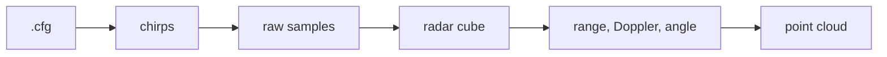
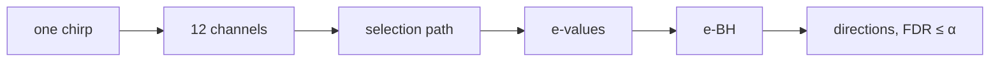
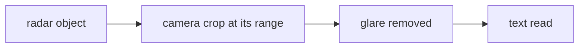
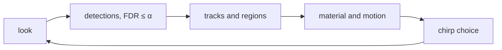
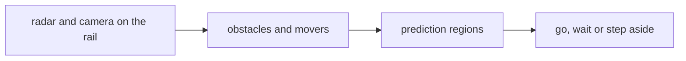

# ARTIFACT

**A**daptive **R**adar **T**racking **I**nference **F**alse **A**larm **C**ontrolled **T**argets: a 77 GHz radar
that guides a camera and works out a scene on its own, what is there, what it is made of, how it moves and where it can
be next, while every detection keeps a guaranteed bound on its false discovery rate.

<p align="center">
  
</p>
<p align="center">
  
  
</p>

*Tracks of a ball and a walking person with their 90 % prediction regions, the camera reading text the radar pointed
it to through a lamp's glare, and a platform that understands the scene in front of it.*

## Implementation

A **TI AWR2944PEVM** radar (77–81 GHz, 4 TX × 4 RX, 12 virtual channels in azimuth) streams its raw samples through a
**TI DCA1000EVM** capture card to a PC, where every method runs in Python. A webcam and a three-axis isel rail complete
the set-up. Every experiment reproduces its results with one command:

```
pip install -r requirements.txt
python <experiment>/run_all.py
```

In the commands of the experiments, `<take>` is a name you choose for a recording, `<session>` the folder that holds
your takes, `<port>` the radar's CLI port (e.g. COM4) and `<data-port>` its data port.

The raw recordings (about 35 GB) are not part of the repository, only each experiment's README figure; `run_all.py`
recreates every table and figure from the recordings.

## Experiments

| Experiment | What it allows for |
| :--- | :--- |
| [Radar Tutorial](radar_tutorial) | Operating the radar from the cable to the point cloud: configuration, raw samples, range, Doppler and angle. |
| [Pattern Measurements](pattern_measurements) | Measuring the radar's sensitivity over the azimuth angle, with and without a printed radome. |
| [Estimation](estimation) | Finding the directions of several reflectors from a single chirp with a guaranteed false discovery rate. |
| [Material Classification](material_classification) | Telling what an object is made of and how it moves from its echo. |
| [Computer Vision](computer_vision) | Letting the radar guide a camera to read text, even with a lamp shining into it. |
| [Tracking](tracking) | Tracking several objects with prediction regions, labels and a cognitive choice of chirps. |
| [Obstacle Experiment](obstacle) | A platform on a rail that understands the scene and decides to go on, wait or step aside. |

**Radar Tutorial.** The radar's configuration sets the chirp, the chirp turns distance into a beat frequency, and FFTs
over samples, chirps and antennas give range, speed and angle.



**Pattern Measurements.** The radar turns past a fixed reflector; the gain of every channel over the angle is the
antenna pattern, and a radome's loss is the difference to the open antenna.


**Estimation.** One range gate is a sparse regression $\mathbf y = \mathbf X\boldsymbol\beta + \boldsymbol\varepsilon$
over a grid of angles. Infini-Rex turns the selection path into e-values, and e-BH keeps
$\mathrm{FDR} = \mathbb E[V/\max(R,1)] \le \alpha$.



**Material Classification.** Fourteen echo features of a 1.6 s window are coded sparsely over all training windows,
$a^\star = \arg\min_{a\ge0}\tfrac12\|y-Da\|_2^2 + \lambda\mathbf 1^\top a$; the class that rebuilds the window best wins.


**Computer Vision.** The radar's range sets the scale of the camera image, so text is always read at the same size,
and the radar locates a lamp so that its glare can be taken out of the picture.



**Tracking.** Every look is detected with FDR control, every object tracked with a region that holds its next position
with probability $1-\varepsilon$, and the next look chosen to reduce the uncertainty most.



**Obstacle Experiment.** On a moving platform the tracks become a world model of obstacles and movers, and a planner
acts on their prediction regions.



## Novelties

| Novelty | What is new | Where |
| :--- | :--- | :--- |
| Infini-Rex | The random dummy experiments of T-Rex in closed form, turned into e-values: FDR-controlled single-snapshot DoA from one selection path, in about a millisecond per range gate. | Estimation |
| FDR-controlled detection guided by tracks | Weighted e-BH with the trackers' prediction regions as prior weights: detection keeps its FDR bound while it looks where objects are expected. | Tracking, Obstacle |
| KalmanCQR | Conformalised quantile regression of Kalman innovations with adaptive conformal inference: distribution-free regions for the next measurement. | Tracking, Obstacle |
| M²-SRC | One sparse representation classifier with a material and a motion head on raw radar features. | Material Classification |
| Cognitive chirp choice | A fast chirp is added to the search chirp whenever it reduces the predicted position uncertainty; all chirps are preloaded, so the radar is never blind. | Tracking, Obstacle |
| MetricSight | Radar range as the scale of the camera image, so text is read at a fixed metric resolution. | Computer Vision |
| Radar-anchored glare removal | The radar locates a lamp; its veil is fitted around that point and subtracted. | Computer Vision |
| Scene understanding with guarantees | FDR-controlled detections, conformal regions and a planner on a moving platform, scored with Scene Panoptic Quality. | Obstacle |


## Folder Structure

```
ARTIFACT/
├── radar_tutorial/           the radar from the cable to the point cloud
├── pattern_measurements/     antenna and radome patterns
├── estimation/               single-snapshot DoA with FDR control
├── material_classification/  material and motion classification
├── computer_vision/          radar-guided reading and glare removal
├── tracking/                 cognitive multi-object tracking
├── obstacle/                 scene analysis on a moving platform
├── isel/                     rail controller tools
├── visualization/            the house style of every figure, code file and README
├── thesis/                   the thesis
├── requirements.txt
└── LICENSE
```

## Thesis

*Cognitive Radar-Vision Scene Analysis via False Discovery Rate Control*, Bachelor thesis in Electrical Engineering and
Information Technology, TU Darmstadt: [thesis/thesis.pdf](thesis/thesis.pdf).
