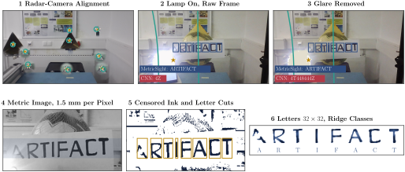

# MetricSight: Radar-Guided Reading and Glare Removal

This folder lets the radar guide a camera: it finds the board, reads the text on it at the radar's scale and removes
the glare of a lamp shining into the camera.



*MetricSight reads 97.9 % of the characters, and 94.7 % with a lamp shining into the camera once its glare is removed, where a CNN reads 17.9 %.*

## Commands

```
pip install -r requirements.txt
```

| Command | What it does |
| :--- | :--- |
| `python run_all.py` | Both readers on every frame, tables and figures into `output/` (`--videos` also the videos). |
| `python -m readers.train` | Draws the training characters and trains both readers. |
| `python check_system.py` | Checks camera and radar (pass or fail). |
| `python align.py solve` | Aligns radar and camera from reflector points. |
| `python read_text.py --take text_1 --truth ARTIFACT --record` | Reads live. |
| `python light_experiment.py --take light_1 --truth ARTIFACT --record` | Reads live while a lamp is switched on and off. |

- **Alignment**: a radar point projects to the pixel $u = c + f\,x\,(1 + k_1 r^2)$.
- **MetricSight**: the radar range sets the image scale $f/R$, so every board is read at 1.5 mm per pixel; letters by
  gradient histograms and ridge regression.
- **Training data**: 18,000 distorted characters (A–Z, 0–9) from 27 fonts, drawn fresh with fixed seeds, the same
  for both readers; 3,600 characters from 3 unseen fonts test them (`output/figures/training_data.pdf`).
- **Glare removal**: the radar object behind the clipped image area is the lamp; its veil $L(\rho) = b + a\rho^{-p}$ is
  fitted around it and subtracted.

## How to Measure

1. Check the hardware: `python check_system.py`
2. Record the empty room: `python radar_setup.py background`
3. Align radar and camera on corner reflectors: `python align.py take align_1 --target-xy "0.50:-0.20:CR"`, then
   `python align.py solve`
4. Read, without and with a lamp: `python read_text.py ...`, `python light_experiment.py ...`
5. Compute everything: `python run_all.py`

## Folder Structure

```
computer_vision/
├── run_all.py                         the whole evaluation
├── dataset.py  evaluate.py  metrics.py  complexity.py   frames, both readers, metrics, run time
├── plots.py  make_video.py  light_video.py              figures and videos
├── check_system.py  radar_setup.py  align.py  read_text.py  light_experiment.py   live programs
├── readers/                           MetricSight, CNN, letter cutting, training
├── backend/                           camera, radar, alignment, glare removal
├── calibration/                       radar-camera alignment
├── config.toml  radar_live.cfg        every setting, the radar configuration
└── output/                            dataset.csv, predictions.csv, tables.tex, figures/
```
