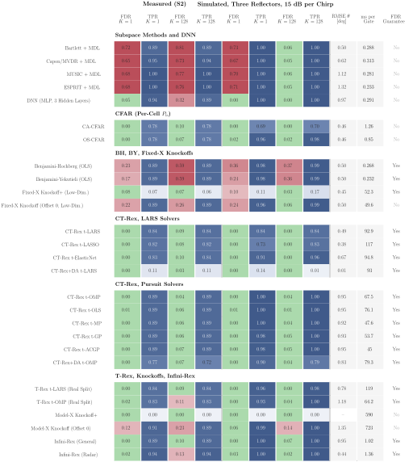

# Estimation: Single-Snapshot DoA with FDR Control

This folder finds the directions of several reflectors from a single radar chirp and compares the classical radar
chain with selectors that control the false discovery rate (FDR).



*With one chirp, Infini-Rex finds 94 % of the measured reflectors at an FDR of 0.02, where 68 % of MUSIC's detections are false.*

## Commands

```
pip install -r requirements.txt
```

| Command | What it does |
| :--- | :--- |
| `python run_all.py` | Runs every method on the measured session and the simulations into `output/`. |
| `python capture.py --cli COM4 --session S2 --plan config/session_plan.json --name <take>` | Records one take with its ground truth. |

One range gate of the 12-element azimuth row is a sparse regression, $\bar{\mathbf y} = \mathbf X\boldsymbol\beta +
\boldsymbol\varepsilon$, with one column of $\mathbf X$ per grid angle; a selected angle is a detected reflector.

- **Classical**: Bartlett, Capon, MUSIC, ESPRIT, CA- and OS-CFAR.
- **Learned**: a small neural network trained on simulated gates.
- **FDR control**: Benjamini–Hochberg, Benjamini–Yekutieli, Fixed-X knockoff+, T-Rex and CT-Rex keep
  $\mathrm{FDR} = \mathbb E[V/\max(R,1)] \le \alpha$ when the array model holds; Model-X and offset-0 knockoffs take a
  level without this guarantee.
- **Infini-Rex**: the random dummies of T-Rex in closed form, $P_t = (1-\rho_t)^{n-1}$, turned into e-values for e-BH,
  so one selection path replaces many random experiments.
- **Range**: the FFT bin centre, the FFT with a parabola through the peak (the estimator of tracking and obstacle) and
  the CZT zoom; on the measured takes the parabola is as accurate as the zoom, which only resolves close reflectors
  better.

## How to Measure

1. Connect the radar and the DCA1000 as in `../radar_tutorial`.
2. Tape every reflector's position and record the takes of the plan:
   `python capture.py --cli COM4 --session S2 --plan config/session_plan.json --name <take> --target-xy "x:y:label"`
3. Compute everything: `python run_all.py`

## Folder Structure

```
estimation/
├── run_all.py                     the whole experiment
├── capture.py  simulation.py      measured takes and simulated scenes
├── dataset.py  evaluate.py        a session as input, every method on every study
├── fdr_control.py  guarantee.py   achieved FDR, on and off the angle grid
├── ranging.py  complexity.py      range estimators, time and memory
├── model_order.py                 why the classical methods over-count on measured data
├── tables.py  plots.py  plotting/ tables and figures
├── core/                          radar, array, range gates, truth, metrics
├── methods/                       one file per method
├── config/                        radar configuration, antenna layout, session plan
└── output/                        dataset.csv, predictions.csv, tables.tex, figures/
```
