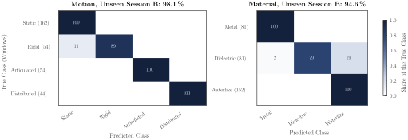

# M²-SRC: Material and Motion Classification

This folder classifies what an object is made of (metal, dielectric, waterlike) and how it moves (static, rigid,
articulated, distributed) from the raw data of a 77 GHz radar.



*On a separately recorded session: motion 98.1 % and material 94.6 % right, every metal and waterlike window included.*

## Commands

```
pip install -r requirements.txt
```

| Command | What it does |
| :--- | :--- |
| `python run_all.py` | Features, evaluation, final model, tables and figures into `output/`. |
| `python record_session.py --cli <port> --plan <plan>` | Guides through the takes of a session. |
| `python run_realtime_sensing.py --cli <port>` | Classifies live with a dashboard. |

- **Features**: 7 of the motion (micro-Doppler) and 7 of the material (echo strength and shape) per 1.6 s window.
- **M²-SRC**: a window is coded sparsely over all training windows,
  $a^\star = \arg\min_{a \ge 0} \tfrac12\|y - Da\|_2^2 + \lambda\mathbf 1^\top a$, and gets the class that rebuilds it best;
  one head for motion, one for material.

## How to Measure

1. Record the empty room and one object at a time (`--list` shows the plans):
   `python record_session.py --cli <port> --plan <plan>`
2. Compute everything: `python run_all.py`

## Folder Structure

```
material_classification/
├── run_all.py                   the whole experiment
├── dataset.py  features.py      recordings to the 14 features
├── classifier.py  evaluate.py   the classifier and its evaluation
├── plots.py                     figures and the live dashboard
├── record_session.py  run_realtime_sensing.py  check_target.py  inspect_recording.py  train_frame_spacing.py   tools
├── utils/                       radar parameters, signal processing, loading takes
├── config/  models/             radar configuration, channel calibration, trained models
└── output/                      dataset.csv, predictions.csv, tables.tex, figures/
```
