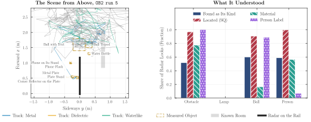

# Obstacle Experiment: Scene Analysis on a Moving Platform

This folder drives radar and camera along a rail through a scene, lets them work out what is there, what it is made of
and how it moves, and decides whether to go on, wait or step aside.



*Scene PQ 56 % at the fewest false detections (FDR 0.17), where the classical CFAR, DBSCAN and nearest-neighbour chain reaches 29 %.*

## Commands

```
pip install -r requirements.txt
```

| Command | What it does |
| :--- | :--- |
| `python run_all.py` | Evaluates the method and its baselines on every recorded run into `output/`. |
| `python experiment.py check --move` | Checks rail, radar and camera. |
| `python experiment.py reference` | Records the empty path along the whole rail. |
| `python experiment.py run --take <take> --read --raw` | Runs the experiment live and records it. |
| `python annotate.py <session>/<take>` | Marks the events of a run on its video. |

- **Detection**: Infini-Rex e-values and weighted e-BH keep the FDR of every look at most $\alpha = 0.1$.
- **Tracking and classes**: the tracker, KalmanCQR and M²-SRC of `../tracking`.
- **World model**: still obstacles as boxes, movers with conformal regions of where they can be within the response
  time $t_\mathrm{resp}$.
- **Planner**: wait for a mover that can reach the platform within $t_\mathrm{resp}$, step aside around obstacles, never
  pass a person.
- **Camera**: looks at the most important object, reads its text and removes the glare of a light.

## How to Measure

1. Zero the rail with `../isel` and check everything: `python experiment.py check --move`
2. Calibrate and record the empty path: `python experiment.py calibrate --target-xyz x:y:z`, then
   `python experiment.py reference`
3. Place the scene and record each run: `python experiment.py run --take <take> --read --raw`
4. Measure the objects into the run's `scene.json` and mark its events: `python annotate.py <session>/<take>`
5. Evaluate everything: `python run_all.py`

## Folder Structure

```
obstacle/
├── run_all.py                    the whole evaluation
├── dataset.py  evaluate.py       runs and ground truth, every metric
├── scene_metrics.py  metrics.py  tracking, Scene PQ, FDR, decisions, intervals
├── doa_study.py  light_replay.py the DoA methods and the light monitor on the recordings
├── tables.py  plots.py           tables and figures
├── experiment.py  annotate.py    the live experiment and its event ground truth
├── config.toml                   every setting
├── methods/                      detection, tracking, world model, planner, camera, classical chain
├── backend/                      radar, rail, camera, live view
└── output/                       dataset.csv, predictions.csv, detections.csv, decisions.csv, tables.tex, figures/
```
