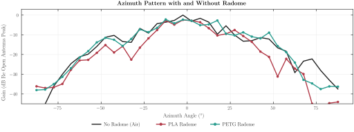

# Pattern Measurements

This folder measures how well the radar sees a target at every azimuth angle, with and without a printed radome.



*Behind PETG the pattern stays within 0.2 dB of the open antenna out to ±60°; PLA costs 3.7 dB there.*

## Commands

```
pip install -r requirements.txt
```

| Command | What it does |
| :--- | :--- |
| `python run_all.py` | Computes every result from the recorded sweeps into `output/`. |
| `python measure_continuous.py --cli COM4 --cfg config/pattern_awr2944P.cfg --cut azimuth --tag air --background` | Records one continuous sweep. |
| `python measure_interactive.py --cli COM4 --cfg config/pattern_awr2944P.cfg --cut azimuth --step 5 --background` | Records a stepwise sweep. |
| `python diagnose_channels.py --cli COM4 --cfg config/pattern_awr2944P.cfg` | Checks every channel at boresight. |

- **One reading**: the empty room subtracted, then the target's energy per channel,
  $A_v = \sqrt{\sum_{|k-k^\star|\le1}|Y_v[k]|^2}$.
- **Pattern**: all 16 channels in 5° bins, 0 dB at the open antenna's peak, so a radome's loss is a lower curve.

## How to Measure

1. Set up the radar as in `../radar_tutorial` and place a corner reflector at boresight.
2. Sweep the radar slowly through ±90° and mark every 30°:
   `python measure_continuous.py --cli COM4 --cfg config/pattern_awr2944P.cfg --cut azimuth --tag air --background`
3. Repeat with each radome and its own tag (`--tag pla`, `--tag petg`).
4. Compute everything: `python run_all.py`

## Folder Structure

```
pattern_measurements/
├── run_all.py                                  every result
├── dataset.py  evaluate.py  tables.py  plots.py  data sets, patterns, tables, figures
├── measure_continuous.py  measure_interactive.py  assign_angles.py  split_runs.py  diagnose_channels.py   measuring
├── capture_lib.py  pattern_lib.py              capture and one gain per channel
├── config/                                     pattern_awr2944P.cfg
├── data/                                       the measured sweeps
└── output/                                     dataset.csv, predictions.csv, tables.tex, figures/
```
