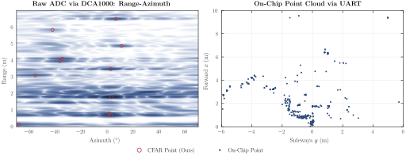

# Radar Tutorial

This folder teaches the radar of every ARTIFACT experiment, from the cable to the point cloud, with code that also runs
on recordings without hardware.



*From raw bytes the chain finds every synthetic target within one velocity bin and 0.3°.*

## Commands

```
pip install -r requirements.txt
```

| Command | What it does |
| :--- | :--- |
| `python run_all.py` | Runs every step offline on the recordings and synthetic targets into `output/`. |
| `python check_setup.py --cli COM4` | Checks ports, CLI, network and the DCA1000 (pass or fail). |
| `python capture_raw.py --cli COM4 --name corner_1m` | Records raw ADC frames through the DCA1000. |
| `python live_raw.py --cli COM4` | Live range-azimuth map and point cloud from the raw stream. |
| `python pointcloud.py --cli COM4 --data COM5` | The chip's own point cloud over UART. |
| `python probe_cli.py --cli COM4` | Shows which form of a CLI command the firmware accepts. |

- **Configuration**: the `.cfg` lines set the chirp, so the range resolution is $\Delta R = c/(2B)$.
- **Raw samples**: the ADC samples the beat $x(t) = A\cos(2\pi f_b t + \varphi)$ with $f_b = 2SR/c$.
- **Radar cube**: 4 TX × 4 RX in time multiplex give 16 virtual channels, 12 of them in one azimuth row.
- **Range, Doppler, angle**: FFTs over samples and chirps, CA-CFAR, and the angle as the peak of
  $|\mathbf a(u)^H\mathbf y|^2$.

## How to Measure

1. Flash TI's out-of-box demo onto the AWR2944P EVM, then check it: `python check_setup.py --cli COM4`
2. Point cloud only: `python pointcloud.py --cli COM4 --data COM5`
3. Raw data with the DCA1000: `python capture_raw.py --cli COM4 --name corner_1m`
4. Compute everything: `python run_all.py`

## Folder Structure

```
radar_tutorial/
├── run_all.py                                   the whole tutorial offline
├── cfgfile.py  uart.py  dca1000.py  capture.py  configuration, CLI, capture card, recording
├── cube.py  dsp.py  tlv.py  simulate.py         radar cube, signal processing, point cloud, synthetic targets
├── check_setup.py  capture_raw.py  live_raw.py  pointcloud.py  probe_cli.py   hardware programs
├── dataset.py  evaluate.py  tables.py  plots.py the offline evaluation
├── config/                                      awr2944p.cfg
├── recordings/                                  a raw capture and a point cloud
└── output/                                      dataset.csv, predictions.csv, tables.tex, figures/
```
