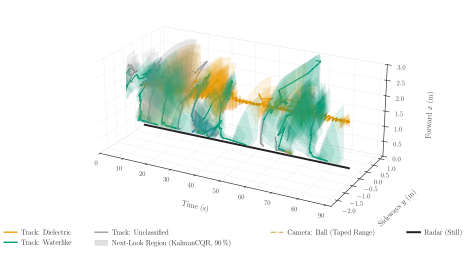

# Cognitive Radar Tracking with FDR Control and Material Classification

This folder tracks every moving object with a 77 GHz radar, classifies its material and motion, chooses its chirps
cognitively and checks everything against a camera.



*Instead of using only the chirp designed for searching, the cognitive design adds a fast chirp whenever it helps, so the tracks are updated twice as often: on the same recording the live tracking score (HOTA) rises from 50 % to 58 %, with 2 % false detections at a level of 10 %.*

## Commands

```
pip install -r requirements.txt
```

| Command | What it does |
| :--- | :--- |
| `python run_all.py` | Reproduces every result in `output/` (`--videos` also renders the live view of every take). |
| `python track_live.py --take <take> --record --raw` | Runs the experiment live and records radar and camera. |
| `python radar_setup.py background` | Records the empty room the method compares against. |
| `python replay.py recordings/<session>/<take>` | Runs the method again on a recorded take, exactly as live. |

- **Detection (Infini-Rex, weighted e-BH)**: e-values per range-Doppler cell and angle; weighted e-BH keeps the false
  discovery rate at most $\alpha = 0.1$ per frame.
- **KalmanCQR**: a Kalman filter per object whose next-look region holds the measurement with probability
  $1 - \varepsilon = 90\,\%$, kept by $\varepsilon_{t+1} = \varepsilon_t + \gamma(\varepsilon - \mathrm{miss}_t)$.
- **M²-SRC**: material and motion of every track from the classifier of `../material_classification`; a track's
  label is the majority of its windows.
- **Cognitive chirp choice**: every frame holds a search chirp and a fast chirp; the fast one is processed when it
  lowers the predicted position uncertainty $U = \frac1H\int \tfrac12\log_2((2\pi e)^2\det P_\mathrm{pos})\,dt$ by
  at least 1 bit.

The camera is the ground truth: HOTA, MOTA and IDF1 per look and live, the FDR, the coverage of the regions and the
classification scores (`tables.tex`); the look policies are compared on the same recording.

## How to Measure

1. Record the empty room: `python radar_setup.py background`
2. Record each scene: `python track_live.py --take <take> --record --raw`
3. Add the take to `dataset.py` and compute everything: `python run_all.py --videos`

## Folder Structure

```
tracking/
├── run_all.py            the whole evaluation (and the videos with --videos)
├── dataset.py            the takes and their camera ground truth
├── evaluate.py           replay, matching, every metric and the look-policy comparison
├── metrics.py            HOTA, CLEAR MOT, IDF1, GOSPA, M2-SRC scores, intervals
├── tables.py  plots.py   tables.tex and figures
├── make_video.py         the live view of a take
├── track_live.py         the live experiment
├── replay.py             the method on a recorded take
├── radar_setup.py        empty-room backgrounds and channel calibration
├── config.toml           every setting
├── methods/              one frame, Infini-Rex, tracker, KalmanCQR, M2-SRC, chirp choice
├── hardware/             radar process and stream, recording, live view, simulation
├── validation/           camera ground truth and alignment
└── output/               dataset.csv, predictions.csv, detections.csv, tables.tex, figures/
```
