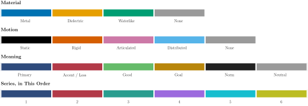

# Visualization

This folder holds the house style of every experiment in ARTIFACT: the figure style ARTIFACT-TeX, the code style and
the README structure, so that all results read like one publication.



*Every colour has one meaning; the label colours are the same in every experiment.*

## Commands

```
pip install -r requirements.txt
```

| Command | What it does |
| :--- | :--- |
| `from visualization import style` | Imports the style (the experiment's scripts put the ARTIFACT folder on `sys.path`). |
| `style.use()` | Switches matplotlib to ARTIFACT-TeX; call it once before drawing. |
| `style.title(ax, "Motion Head")` | Sets a bold title: on an axes the panel title, on a figure the title over all panels. |
| `style.save(target, fig)` | Applies Title Case to every text and writes the PDF (a path, or a page of `style.pdf(...)`). |
| `with style.pdf(path) as pdf:` | Opens a multi-page PDF for figures that belong together. |
| `style.legend_below(fig, axs)` | One legend under the figure with the entries of all given panels. |
| `python style.py` | Draws `palette.svg`, the picture above. |

## Figures

**Text.** Real LaTeX only (`text.usetex`, Computer Modern), never matplotlib's imitation. 8 pt text, 7 pt ticks and
legends; titles bold, axis labels plain. Title Case for titles, legends, axis and colour-bar labels and class names:
main words capitalised; of, or, and, per, vs., to, the …, units (m/s, dB, ms), maths and names with `_` unchanged
(`style.save` does it). Variable and feature names are set as `$\mathtt{name}$`.

**Layout.** Widths `style.SINGLE` = 3.5 in and `style.DOUBLE` = 7.16 in (journal columns), so a figure appears at its
true size. Boxed axes, ticks inward on all sides, light grid, frameless legends.

**Legends.** Never on the data and never cramped: at most about five entries inside an axes. Anything longer goes
under the figure with `style.legend_below(fig, axs)`, which collects the entries of all panels once. `style.save`
keeps every legend text at 6.5 pt or more, and the legend spacing is set in the style.

**Colours.** Colour shows meaning; line style, marker or hatch shows a second dimension.

| Name | Colour | Meaning |
| :--- | :--- | :--- |
| `MATERIAL_COLORS` | #0072B2 #E69F00 #009E73 | metal, dielectric, waterlike (fixed in every experiment) |
| `MOTION_COLORS` | #000000 #D55E00 #CC79A7 #56B4E9 | static, rigid, articulated, distributed (fixed) |
| `PRIMARY` | #2F4B7C | the method, the main result, held-out data |
| `ACCENT` / `LOSS` | #B23A48 | the comparison or reference; wrong decisions, losses |
| `GOOD` | #66BB6A | correct, validated (filled areas only) |
| `GOAL` | #B8860B | a goal, target or ground-truth value (always with a star marker or dash-dot line) |
| `NORM` | #222222 | the norm or reference line, text |
| `MUTED` | #9A9A9A | neutral: training, chance, thresholds, nothing detected (dashed or dotted lines) |
| `SERIES` | 6 colours, in order | many things without label colours (e.g. several targets): take them in order, never cycle |
| `HATCHES` | 6 patterns | second encoding next to colour for black-and-white print and colour-blind readers |
| `SEQUENTIAL` | white → #2F4B7C → #14213D | heat maps and magnitudes |

All pairs stay distinguishable for the three common colour-vision deficiencies; gold and the dielectric orange are
close, so gold always comes with its own marker. Orange is never the colour of a single series.

**Figure types.** PDF only, related figures grouped in few multi-page PDFs, dashboards one PDF each; the only other
format is the README picture of an experiment (SVG). Box plots are slim (width 0.28) with a white median. Confusion
matrices show only classes that exist, unseen predicted combinations in one "Other" column, cells in % of the true
class ("$<$1" instead of 0). Every figure says which data it uses; unseen test data is marked as such.

## Code

- Folder per experiment with small modules, one job each: data, method, evaluation, `plots.py`, `run_all.py`.
- `python run_all.py` reproduces every result into `output/`: `dataset.csv`, `predictions.csv`, `tables.tex`
  (one `\newcommand{\mcName}{...}` per booktabs table; the thesis does `\input{tables.tex}` once) and `figures/`.
  It recomputes only what changed.
- Every `.py` file starts with exactly this header and has no further comments or docstrings; names and order explain the code:

```python
"""
name.py - one or two sentences: what the file does and its most important detail.

    python name.py --option value        (for a module: from experiment.name import Thing)
"""
```

- Scripts put the ARTIFACT folder on the path: `sys.path.insert(0, str(Path(__file__).resolve().parent.parent))`.
- Files shared with another experiment stay byte-identical: edit the original, copy, compare with `cmp`.

## README of an Experiment

Professional and short, Title Case headings, in this order:

````markdown
# Title of the Experiment

One welcoming sentence on what the folder does.


*One line: the strongest, most intuitive result.*

## Commands

```
pip install -r requirements.txt
```

| Command | What it does |
| :--- | :--- |
| `python run_all.py` | One sentence. |

Short paragraphs with the method and its essential maths ($...$).

## How to Measure

1. One step per line, each with its command.

## Folder Structure

```
experiment/
├── run_all.py      one short comment per file or folder
└── output/
```
````

No references, credits, history or self-assessment sections; every experiment has its own `requirements.txt`.

## Folder Structure

```
visualization/
├── style.py          ARTIFACT-TeX: rcParams, palette, Title Case, saving
├── palette.svg       the palette preview (python style.py)
├── requirements.txt
└── __init__.py
```
